# CloudDevOpsProject

### Microservices on AWS EKS with Terraform, GitHub Actions and ArgoCD

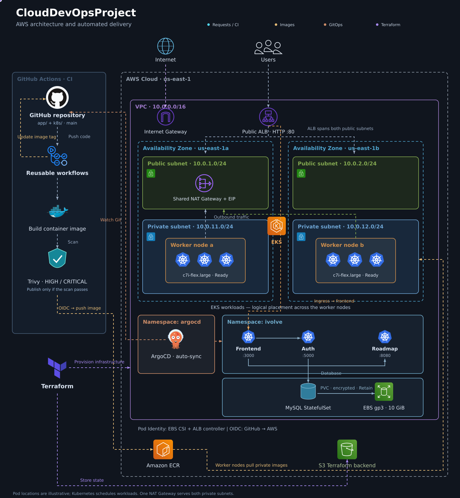

## Project Overview

An end-to-end DevOps project that takes a three-service application from local Docker Compose development to an AWS EKS deployment. Terraform provisions the infrastructure, GitHub Actions builds and scans container images, and ArgoCD deploys the desired application state from Git.

Users register and sign in through the frontend, then access a DevOps training roadmap. Authentication data is stored in MySQL on persistent storage.

**Repository:** [Hager-83/CloudDevOpsProject](https://github.com/Hager-83/CloudDevOpsProject)  
**Application source:** adapted from [IbrahimAdel15/iVolveFinalProject](https://github.com/IbrahimAdel15/iVolveFinalProject)  
**Deployment region:** `us-east-1` · **Application namespace:** `ivolve`

### Core Technologies

Docker · Docker Compose · Terraform · AWS VPC · Amazon EKS · Amazon ECR · Amazon S3 · IAM OIDC · EKS Pod Identity · Kubernetes · Helm · GitHub Actions · Trivy · ArgoCD

### Delivery Model

1. A developer pushes a service change to `main`.
2. That service's workflow calls the reusable GitHub Actions workflow.
3. CI builds the image, scans it with Trivy, authenticates to AWS using OIDC, and pushes to ECR.
4. CI removes the local image, updates its Kubernetes image reference, and pushes the manifest change to the **same repository**.
5. ArgoCD detects the Git change and reconciles the application in EKS.
6. Users access the frontend through a public Application Load Balancer.

GitHub Actions handles **image delivery**; ArgoCD handles **application deployment**. No long-lived AWS access keys are stored in GitHub Actions.

## Table of Contents

1. [Application and Repository Structure](#1-application-and-repository-structure)
2. [Local Development with Docker Compose](#2-local-development-with-docker-compose)
3. [Infrastructure Provisioning with Terraform](#3-infrastructure-provisioning-with-terraform)
4. [Kubernetes and Persistent Storage](#4-kubernetes-and-persistent-storage)
5. [Public Access with ALB Ingress](#5-public-access-with-alb-ingress)
6. [Continuous Integration with GitHub Actions](#6-continuous-integration-with-github-actions)
7. [Continuous Deployment with ArgoCD](#7-continuous-deployment-with-argocd)
8. [Live CI/CD Demo](#8-live-cicd-demo)
9. [Verification and Troubleshooting](#9-verification-and-troubleshooting)
10. [Design Limitations and Cleanup](#10-design-limitations-and-cleanup)

## 1. Application and Repository Structure

| Component | Technology | Internal port | Responsibility |
|---|---|---|---|
| Frontend | Node.js 22 / Express / EJS | `3000` | Login, registration, session handling and roadmap UI |
| Authentication service | Python 3.12 / Flask | `5000` | Account creation, bcrypt password hashing and authentication |
| Roadmap service | Java 21 / Spring Boot | `8080` | DevOps roadmap API |
| Database | MySQL 8.0 | `3306` | Persistent account data |

The frontend calls the authentication and roadmap services over internal service names. Only the authentication service connects to MySQL.

| Path | Contents |
|---|---|
| [`app/`](app/) | Application source and per-service Dockerfiles |
| [`docker-compose.yml`](docker-compose.yml) | Local application and database orchestration |
| [`.env.example`](.env.example) | Environment variable template without secret values |
| [`terraform/bootstrap/`](terraform/bootstrap/) | S3 backend bucket and its protections |
| [`terraform/modules/network/`](terraform/modules/network/) | VPC, subnets, routing, NAT and Network ACLs |
| [`terraform/modules/eks/`](terraform/modules/eks/) | EKS, node groups, access entries, storage add-ons and controller IAM |
| [`terraform/modules/ecr/`](terraform/modules/ecr/) | Private image repositories |
| [`terraform/modules/github-oidc/`](terraform/modules/github-oidc/) | GitHub OIDC provider and ECR publishing role |
| [`k8s/`](k8s/) | Application manifests, storage configuration and Ingress |
| [`.github/workflows/`](.github/workflows/) | Three service workflows and a reusable image workflow |
| [`argocd/application.yaml`](argocd/application.yaml) | GitOps Application targeting `k8s/` on `main` |
| [`Images/`](Images/) | Architecture, screenshots and the short deployment demo |

## 2. Local Development with Docker Compose

### Prerequisites

- Docker Engine and the Docker Compose plugin.
- Git.
- For AWS deployment: AWS CLI v2 with `aws login`, Terraform `>= 1.15.0`, kubectl compatible with the cluster, and Helm. The deployment was verified with Helm 3.
- An AWS identity authorized to provision the project resources and assume/pass the required IAM roles.

### Step 1: Clone and configure

```bash
git clone https://github.com/Hager-83/CloudDevOpsProject.git
cd CloudDevOpsProject
cp .env.example .env
```

Fill in `MYSQL_PASSWORD`, `MYSQL_ROOT_PASSWORD` and `SESSION_SECRET` with separate strong values. Keep `MYSQL_DATABASE=ivolve` and `MYSQL_USER=ivolve` unless intentionally changing the database configuration.

Use unquoted `KEY=value` entries without surrounding whitespace: the same file is also consumed by `kubectl --from-env-file`. Never commit `.env` or generated Secret values.

### Step 2: Build and start

```bash
docker compose config --quiet
docker compose up -d --build
docker compose ps
```

Open [http://localhost:3000](http://localhost:3000). Create an account, sign in, and open the roadmap.

MySQL has a database health check; the authentication service waits for it to become healthy. The frontend waits for the authentication health check and roadmap startup.

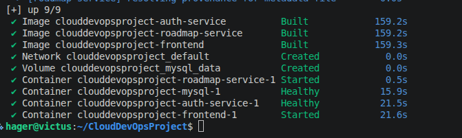

*The three service images build successfully, and Docker Compose starts the application with healthy MySQL and authentication containers.*

### Step 3: Verify local persistence

MySQL mounts the named volume `mysql_data` at `/var/lib/mysql`.

```bash
docker inspect "$(docker compose ps -q mysql)" --format '{{json .Mounts}}'
docker compose down
docker compose up -d
```

Sign in again using the account created before the restart. Do not use `docker compose down -v` when retaining the database.

<details>
<summary>Local volume and container recreation evidence</summary>

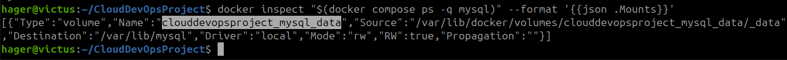

*The MySQL data directory is backed by a Docker named volume.*

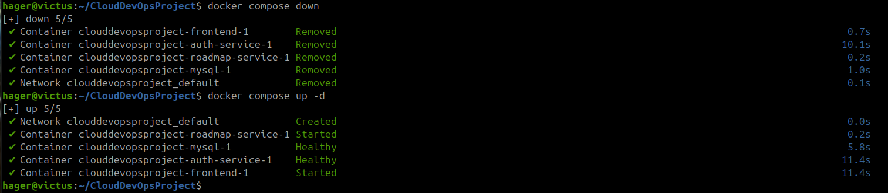

*Containers are removed and recreated while the named volume is retained.*

</details>

Stop local containers when finished:

```bash
docker compose down
```

## 3. Infrastructure Provisioning with Terraform

### Provisioned Infrastructure

| Module / layer | Implemented resources |
|---|---|
| Bootstrap | S3 bucket with versioning, AES256 encryption, all public access blocked and `prevent_destroy` |
| Network | VPC `10.0.0.0/16`, four subnets across two AZs, IGW, one NAT Gateway with Elastic IP, route tables and separate public/private NACLs |
| EKS | Cluster `ivolve-eks`, two managed node groups, IAM roles and API-based cluster administrator access |
| Storage | EKS Pod Identity Agent, EBS CSI Driver, its IAM role and Pod Identity association |
| Load balancing | Controller IAM policy, role and Pod Identity association; controller installed separately with Helm |
| ECR | Three private repositories with immutable tags and AES256 encryption |
| GitHub OIDC | Provider, repository/branch-restricted role trust and ECR push policy |

**Subnet layout**

| Availability Zone | Public subnet | Private worker subnet |
|---|---|---|
| `us-east-1a` | `10.0.1.0/24` | `10.0.11.0/24` |
| `us-east-1b` | `10.0.2.0/24` | `10.0.12.0/24` |

Both private subnets use the NAT Gateway in the public subnet in `us-east-1a`. Public subnets carry the ALB discovery tag; worker subnets do not assign public IP addresses.

### Step 1: Authenticate to AWS

```bash
aws login --profile ivolve
export AWS_PROFILE=ivolve
export AWS_REGION=us-east-1
aws sts get-caller-identity --profile ivolve --query Arn --output text
```

The local provisioning identity is `ivolve-terraform`, separate from the GitHub Actions role.

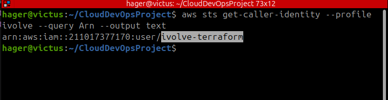

*AWS STS confirms the dedicated IAM identity used for local Terraform execution.*

The provisioning identity needs the relevant S3/backend, VPC/EC2 networking, ECR, EKS, OIDC and project IAM permissions, including `iam:PassRole`. EKS node groups also require access to their service-linked role. Controller roles use EKS Pod Identity; the GitHub publishing role uses GitHub OIDC.

### Step 2: Create the S3 backend — initial setup only

```bash
terraform -chdir=terraform/bootstrap init
terraform -chdir=terraform/bootstrap validate
terraform -chdir=terraform/bootstrap plan
terraform -chdir=terraform/bootstrap apply
```

The following are **original bootstrap provisioning screenshots**. This plan creates **four S3-related resources**; it is not a plan for the entire EKS application stack.

<details>
<summary>Original S3 bootstrap plan and apply</summary>

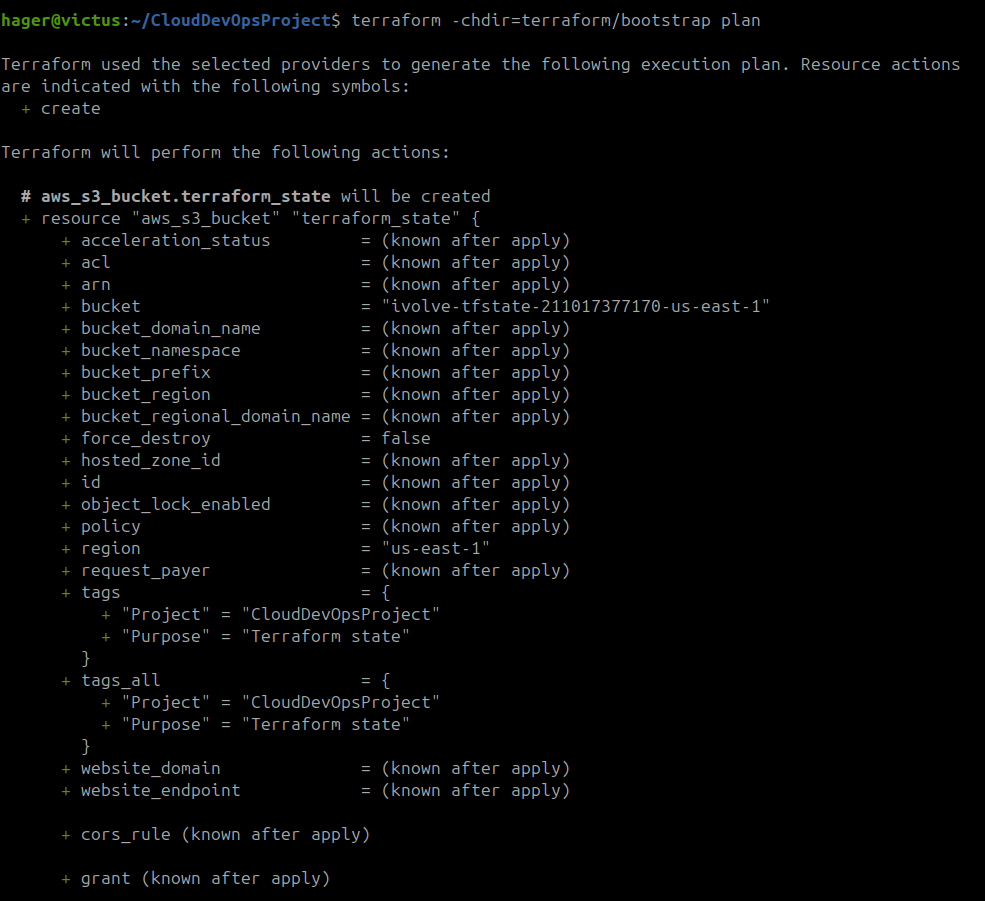

*The bootstrap plan creates the Terraform state bucket.*

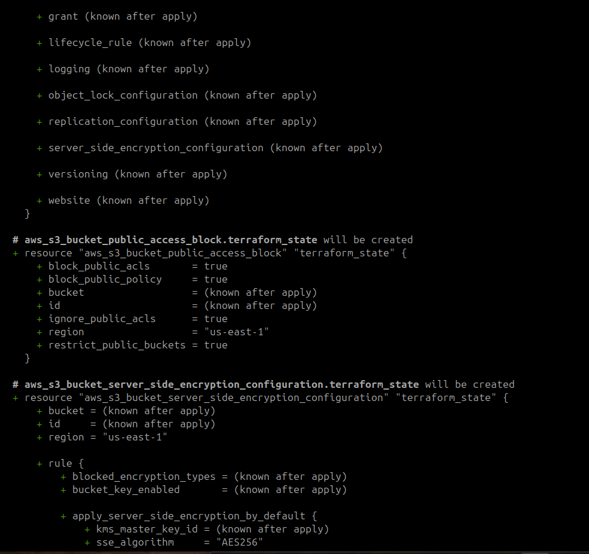

*Public access blocking and encryption configuration are included in the bootstrap plan.*

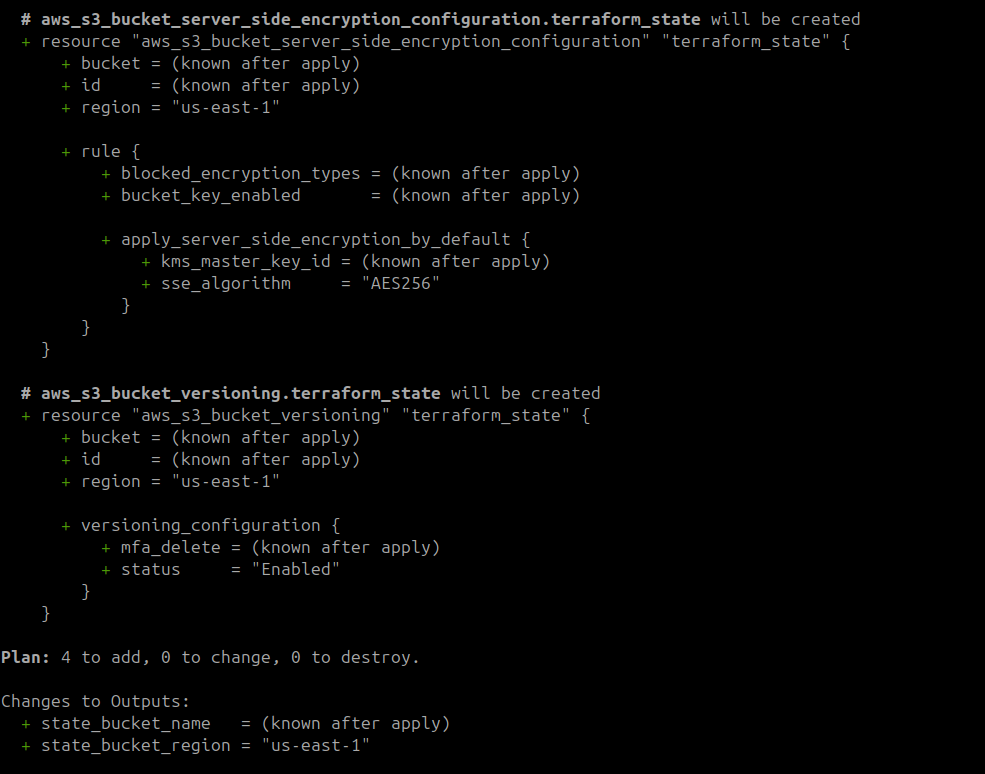

*The bootstrap plan includes versioning and reports four resources to add.*

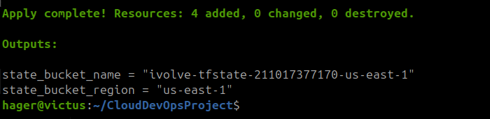

*The initial bootstrap apply successfully creates all four state-bucket resources.*

</details>

The main backend in [`terraform/backend.tf`](terraform/backend.tf) uses:

```hcl
bucket       = "ivolve-tfstate-211017377170-us-east-1"
key          = "ivolve/terraform.tfstate"
region       = "us-east-1"
encrypt      = true
use_lockfile = true
```

The bootstrap itself uses local state; keep a secure backup of that state. Native S3 locking is enabled for the **main** infrastructure state; no DynamoDB locking table is used.

### Step 3: Set the administrator CIDR

Find the current public IPv4 address:

```bash
curl -4 https://checkip.amazonaws.com
```

Create or edit the untracked `terraform/terraform.tfvars`:

```hcl
aws_region   = "us-east-1"
project_name = "ivolve"
admin_cidr   = "YOUR_CURRENT_PUBLIC_IPV4/32"
```

Replace the placeholder with the actual IPv4 address. The EKS API has private access enabled and restricts public access to this CIDR.

### Step 4: Initialize, review and provision

```bash
terraform -chdir=terraform init
terraform -chdir=terraform fmt -check -recursive
terraform -chdir=terraform validate
terraform -chdir=terraform plan
terraform -chdir=terraform apply
```

For an existing deployment, inspect the plan before applying. A subsequent `No changes` result is a configuration consistency check, not evidence of initial resource creation.

**Adapting the repository:** the account ID, backend bucket, EKS access principal, CI registry/role ARN, subnet AZs and GitHub OIDC subject are project-specific. Update these together before deploying to another account or repository; changing only `github_repository` does not rewrite the currently explicit OIDC subject.

### Step 5: Verify the network, EKS and ECR

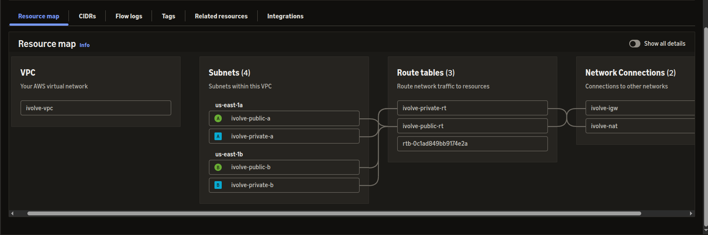

*Public and private subnets span two Availability Zones with separate routing and a shared NAT Gateway.*

The cluster uses Kubernetes `1.35` and two managed node groups: `ivolve-nodes-a` and `ivolve-nodes-b`. Each group has desired/minimum/maximum size `1` and uses one On-Demand `c7i-flex.large` worker with a 20 GiB disk and AL2023 x86_64 AMI.

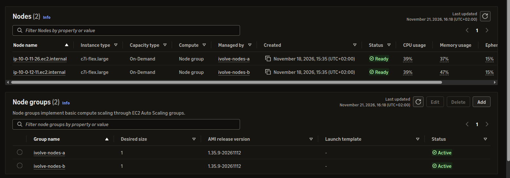

*Two active managed node groups each provide one Ready worker node.*

```bash
aws eks update-kubeconfig \
  --name ivolve-eks --region us-east-1 \
  --profile ivolve --alias ivolve-eks

kubectl --context ivolve-eks get nodes -L topology.kubernetes.io/zone
```

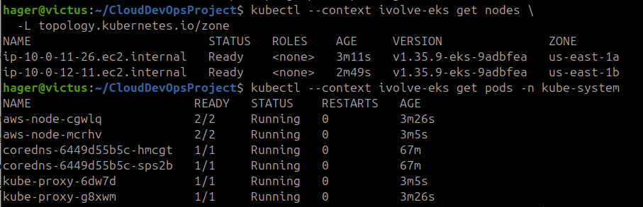

*The original cluster verification shows both nodes Ready in different Availability Zones and the core networking/DNS pods running.*

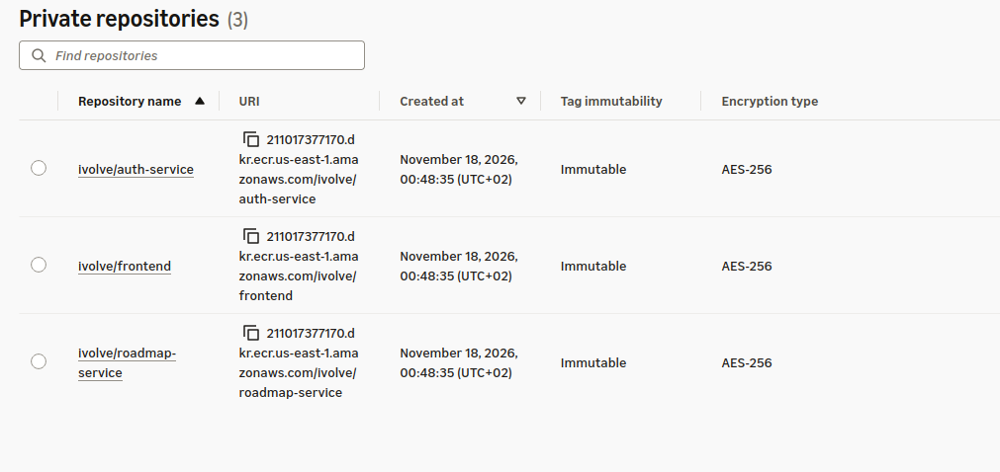

*Separate authentication, frontend and roadmap repositories use immutable tags and AES-256 encryption.*

## 4. Kubernetes and Persistent Storage

### Application Resources

| Resource | Configuration |
|---|---|
| Namespace | `ivolve` |
| Deployments | One replica each for frontend, authentication and roadmap |
| Services | Internal ClusterIP services for the three application components |
| ConfigMap | Database host/port and internal service URLs |
| Secret | Database credentials and frontend session secret, created separately |
| MySQL | Single-replica StatefulSet and headless Service |
| StorageClass | `ivolve-gp3`, EBS CSI provisioner, encrypted gp3, `WaitForFirstConsumer`, expansion enabled, `Retain` |
| Persistent claim | `mysql-data-mysql-0`, 10 GiB, `ReadWriteOnce` |
| Health checks | Startup/readiness/liveness probes; authentication readiness checks database connectivity |

### Step 1: Create configuration prerequisites

After EKS provisioning, verify the Pod Identity and EBS CSI components:

```bash
kubectl --context ivolve-eks -n kube-system rollout status daemonset/eks-pod-identity-agent --timeout=180s
kubectl --context ivolve-eks -n kube-system rollout status deployment/ebs-csi-controller --timeout=180s
kubectl --context ivolve-eks -n kube-system rollout status daemonset/ebs-csi-node --timeout=180s

kubectl --context ivolve-eks apply -f k8s/namespace.yaml
kubectl --context ivolve-eks -n ivolve create secret generic app-secrets \
  --from-env-file=.env --dry-run=client -o yaml \
  | kubectl --context ivolve-eks apply -f -
```

Create the Secret **before** ArgoCD deploys the application. The Secret is intentionally absent from Git. Changing the environment file does not change an already initialized MySQL database or automatically rotate its users' passwords.

### Step 2: Let ArgoCD deploy the manifests

The ArgoCD Application described in [Section 7](#7-continuous-deployment-with-argocd) reconciles `k8s/`, including the StorageClass, ConfigMap, MySQL, application services and Ingress. Install the load balancer controller before expecting the Ingress to receive an address.

### Step 3: Verify workloads and storage

```bash
kubectl --context ivolve-eks -n ivolve \
  get deployments,statefulsets,pods,pvc,svc
```

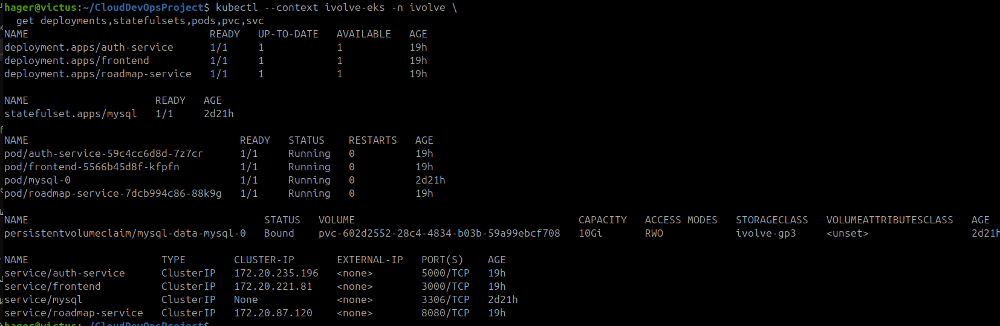

*The three application Deployments and MySQL StatefulSet are ready, with all Pods running and the MySQL PVC Bound.*

The PVC preserves MySQL data independently of the Pod lifecycle. A `Bound` claim proves provisioning/attachment readiness; a fresh login after replacing `mysql-0` is the separate data-persistence acceptance test.

## 5. Public Access with ALB Ingress

### Step 1: Install the AWS Load Balancer Controller

Terraform creates its IAM role and Pod Identity association. Helm installs the controller using the chart version recorded in the repository.

```bash
helm repo add eks https://aws.github.io/eks-charts
helm repo update

LBC_CHART_VERSION=$(cat terraform/modules/eks/load-balancer-chart-version.txt)
IVOLVE_VPC_ID=$(terraform -chdir=terraform output -raw vpc_id)

helm upgrade --install aws-load-balancer-controller \
  eks/aws-load-balancer-controller \
  --version "$LBC_CHART_VERSION" \
  --kube-context ivolve-eks --namespace kube-system \
  --set clusterName=ivolve-eks \
  --set region=us-east-1 \
  --set vpcId="$IVOLVE_VPC_ID" \
  --set serviceAccount.create=true \
  --set serviceAccount.name=aws-load-balancer-controller \
  --wait --timeout 5m
```

The recorded chart version is `3.6.3`. Its IAM policy is stored in [`load-balancer-iam-policy.json`](terraform/modules/eks/load-balancer-iam-policy.json).

### Step 2: Ingress routing

[`k8s/ingress.yaml`](k8s/ingress.yaml) configures an internet-facing ALB, HTTP listener on port `80`, IP targets, and `/` routing to the frontend Service on port `3000`. The controller reconciles this Ingress after ArgoCD applies it.

```bash
kubectl --context ivolve-eks -n ivolve get ingress frontend
```

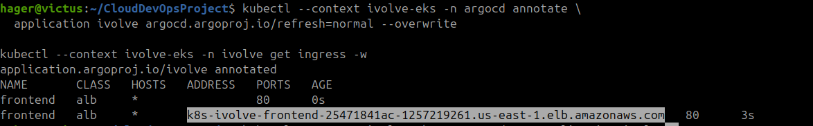

*The frontend Ingress receives an AWS Application Load Balancer DNS name.*

Get the current application URL:

```bash
kubectl --context ivolve-eks -n ivolve get ingress frontend \
  -o jsonpath='http://{.status.loadBalancer.ingress[0].hostname}{"\n"}'
```

The application endpoint does not require port-forwarding. ALB hostnames can change when the Ingress/load balancer is recreated, so retrieve the live address instead of relying on an old URL.

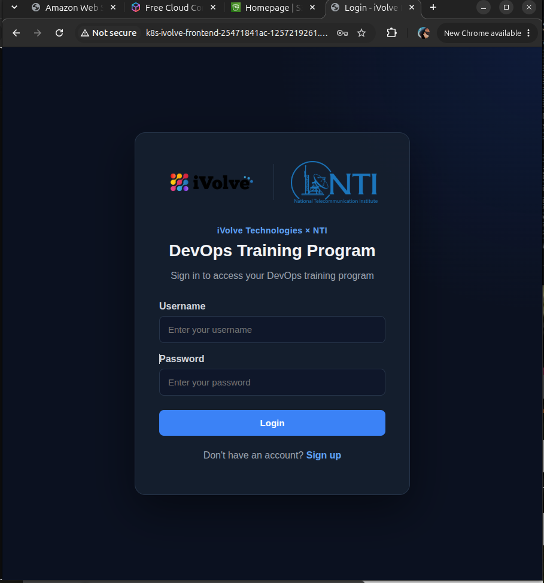

*The public frontend serves the account login page through the ALB.*

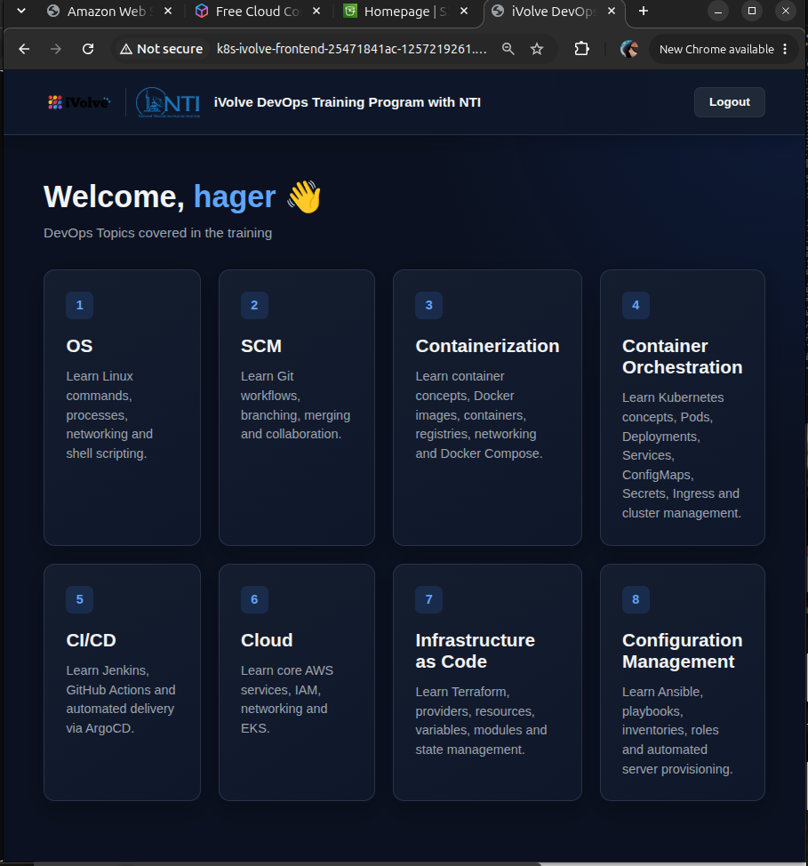

*Successful authentication allows access to the roadmap content.*

## 6. Continuous Integration with GitHub Actions

### Workflows

| Workflow | Purpose |
|---|---|
| [`auth-service.yml`](.github/workflows/auth-service.yml) | Builds authentication service changes |
| [`frontend.yml`](.github/workflows/frontend.yml) | Builds frontend changes |
| [`roadmap-service.yml`](.github/workflows/roadmap-service.yml) | Builds roadmap service changes |
| [`reusable-build.yml`](.github/workflows/reusable-build.yml) | Implements the shared image delivery pipeline via `workflow_call` |

The service workflows run on relevant `main` pushes or manual `workflow_dispatch`. They call the reusable workflow rather than duplicating its implementation. The reusable workflow is invoked by its callers; it is not a fourth application build to run manually.

### Pipeline Stages

| Stage | Behavior |
|---|---|
| Checkout | Fetch the source and Git history |
| Build | Build `app/<service>` on a GitHub-hosted `ubuntu-latest` runner |
| Scan | Run Trivy; HIGH or CRITICAL findings block publishing, including unfixed findings |
| Authenticate | Assume the AWS publishing role using GitHub OIDC and verify identity |
| Push | Authenticate Docker to ECR and publish the image |
| Delete locally | Remove the runner's image, including cleanup after failures |
| Update manifests | Replace the image in `k8s/<service>.yaml` and create a bot commit |
| Push manifests | Push to `main`, rebasing/retrying if another workflow pushed first |

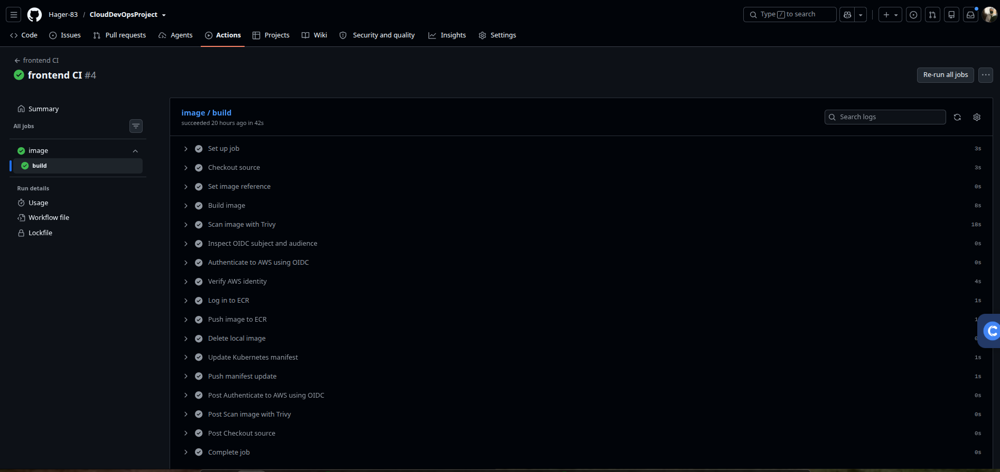

*The reusable frontend pipeline completes image building, Trivy scanning, OIDC authentication, ECR publishing, cleanup and the Git manifest update.*

### Authentication, Permissions and Tags

- `id-token: write` lets the job obtain an OIDC token.
- `contents: write` lets the job push its manifest update using the built-in `GITHUB_TOKEN`; a separate personal access token is not required by this workflow.
- The AWS role allows ECR publishing only to the three project repositories; token acquisition uses `ecr:GetAuthorizationToken`.
- Trust checks audience `sts.amazonaws.com` and the repository-specific `main` subject. This repository uses the subject containing owner/repository IDs; see the [trust configuration](terraform/modules/github-oidc/main.tf).
- Image tags use `<commit-SHA>-<run-ID>-<run-attempt>` to avoid overwriting immutable ECR tags.
- Push path filters include the service directory and workflow files, not `k8s/**`. Manifest-only commits therefore do not request another image build. Per-service concurrency and push retries coordinate simultaneous runs.

For an initial build, use **Actions → service CI → Run workflow → main** for each service. Confirm each ECR image exists before expecting its Deployment to start in a new environment. A fork must update the publishing role, registry, trust subject, repository URL and image references.

## 7. Continuous Deployment with ArgoCD

### Step 1: Install ArgoCD

The following reproduces the installation method used for this project. The upstream `stable` URL can change; record/pin a release when reproducing the environment long-term.

```bash
kubectl --context ivolve-eks create namespace argocd \
  --dry-run=client -o yaml | kubectl --context ivolve-eks apply -f -

kubectl --context ivolve-eks apply --server-side -n argocd \
  -f https://raw.githubusercontent.com/argoproj/argo-cd/stable/manifests/install.yaml

kubectl --context ivolve-eks -n argocd get deployments -o name \
  | while read -r resource; do
      kubectl --context ivolve-eks -n argocd rollout status "$resource" --timeout=600s || break
    done

kubectl --context ivolve-eks -n argocd rollout status \
  statefulset/argocd-application-controller --timeout=600s
```

### Step 2: Create the Application

With the application Secret and controller prerequisites ready:

```bash
kubectl --context ivolve-eks apply -f argocd/application.yaml
kubectl --context ivolve-eks -n argocd get application ivolve
```

The version-controlled Application targets this repository, revision `main`, path `k8s/`, and namespace `ivolve`. Automated sync and self-healing are enabled. Automated pruning is disabled: removing a manifest from Git does not automatically delete its live resource.

### Step 3: Open the UI

```bash
kubectl --context ivolve-eks -n argocd port-forward service/argocd-server 8090:443
```

Open [https://localhost:8090](https://localhost:8090). Use `admin` and the existing password. For a fresh installation, retrieve the initial password privately:

```bash
kubectl --context ivolve-eks -n argocd get secret argocd-initial-admin-secret \
  -o jsonpath='{.data.password}' | base64 -d
echo
```

The default installation uses a self-signed certificate. Keep the forwarding terminal open and exclude password output from screenshots and recordings.

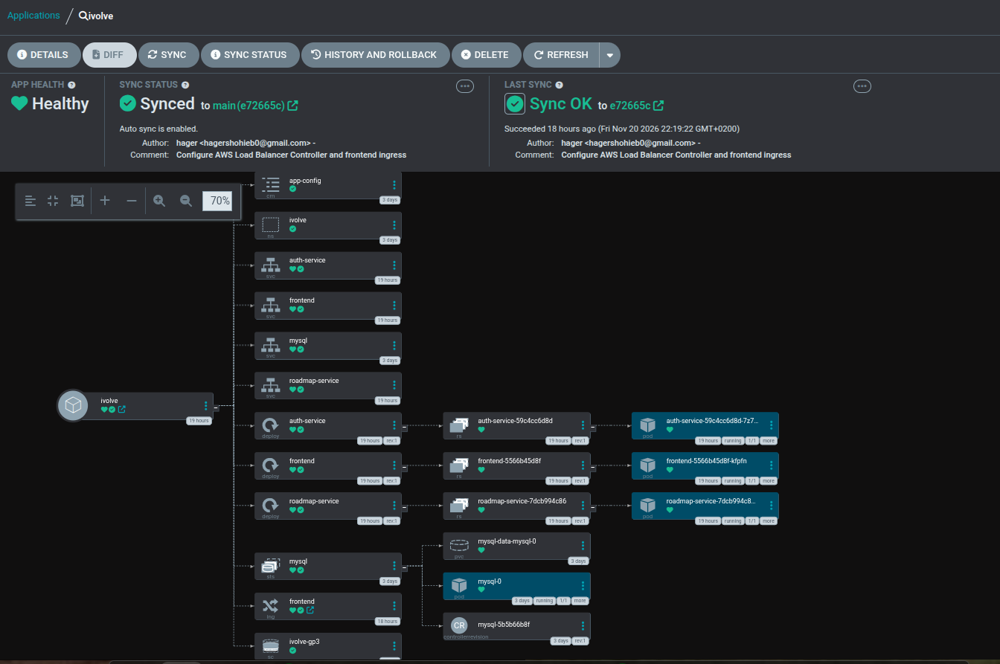

*ArgoCD reports the application as Synced and Healthy, with auto-sync enabled and the managed Kubernetes resource tree visible.*

The UI shows live resource health, image references, deployment events and sync history. Build and Trivy logs remain in GitHub Actions.

## 8. Live CI/CD Demo

The recorded demonstration changes a visible frontend heading to **DevOps Training Program — CI/CD Demo** and follows it through the delivery workflow.

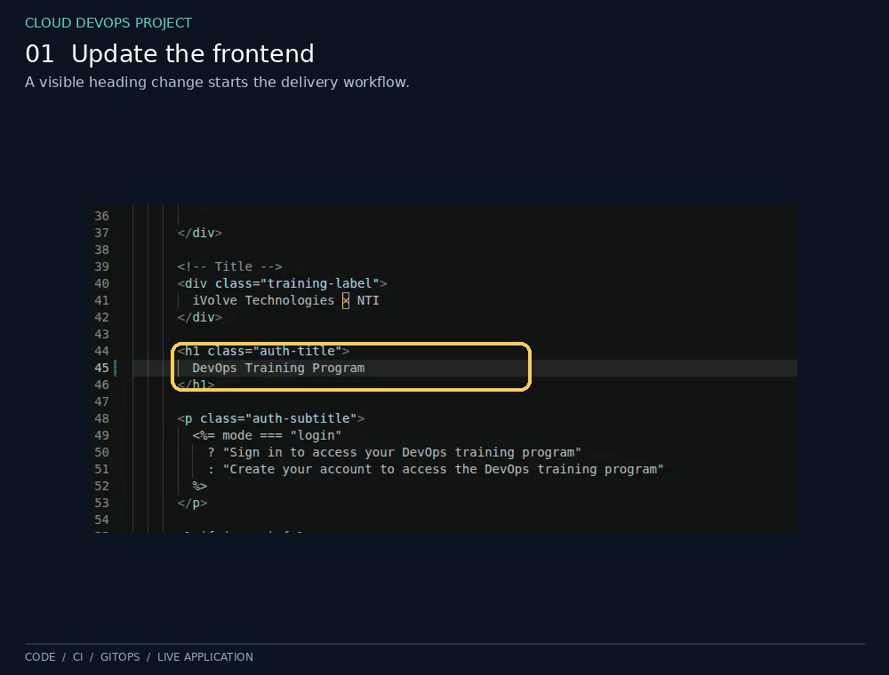

*Frontend source change → GitHub Actions → ECR publication and Git image-reference update → ArgoCD rollout → updated public application.*

The GIF is an edited, approximately 26-second summary. Waiting time and unrelated navigation are omitted; the transition card indicates the time skip. The recording includes ArgoCD progressing to the new revision and returning to Healthy, followed by the changed heading and roadmap access.

To repeat the test:

1. Update a visible heading in `app/frontend/views/auth.ejs`.
2. Commit and push that file to `main`.
3. Observe frontend CI finish successfully and the bot update `k8s/frontend.yaml`.
4. Compare the new image tag in Git/ECR with the live frontend Deployment.
5. Allow ArgoCD to reconcile the new revision, then reload the public page.

Do not manually apply the new Deployment or run a separate Docker build during this test; those steps are performed by CI and ArgoCD.

## 9. Verification and Troubleshooting

### Recorded Verification

| Check | Evidence / observation |
|---|---|
| Local startup | Compose startup and named-volume screenshots |
| Backend creation | Original four-resource S3 plan and successful apply |
| Worker placement | Two Ready nodes in different Availability Zones |
| Application readiness | Three ready Deployments, ready MySQL and Bound PVC |
| Public application | ALB access, login page and roadmap screenshots |
| Image delivery | Successful GitHub Actions run with Trivy, OIDC and ECR steps |
| GitOps update | Recorded frontend change reaches ArgoCD and the public UI |
| Kubernetes persistence across Pod replacement | Storage is provisioned; a dedicated before/after account test is not included in the supplied evidence |

Useful checks:

```bash
terraform -chdir=terraform validate
terraform -chdir=terraform plan
kubectl --context ivolve-eks get nodes -L topology.kubernetes.io/zone
kubectl --context ivolve-eks -n ivolve get pods,pvc,svc,ingress
kubectl --context ivolve-eks -n argocd get application ivolve
```

### Troubleshooting Notes

| Symptom | Resolution used / diagnostic approach |
|---|---|
| kubectl times out after changing networks | Compare the current public IPv4 with EKS `publicAccessCidrs`; update `admin_cidr` in Terraform, review and apply the CIDR-only plan |
| AWS CLI session expired | Run `aws login --profile ivolve` and verify the STS identity |
| OIDC AssumeRole denied | Compare the actual token's `sub` and `aud` with the IAM trust, including the repository IDs used in this project; do not print the raw token |
| EKS node group cannot read its service-linked role | Verify the provisioning identity's `iam:GetRole` and service-linked role creation permissions |
| Instance type rejected by account plan | Check eligible types and region availability; this deployment uses `c7i-flex.large`, not the initially attempted `t3.medium` |
| MySQL startup reports invalid database name | Remove trailing whitespace from `MYSQL_DATABASE`; inspect logs and repair the initialized database/user as needed without deleting the PVC |
| Image scan fails | Review and fix the reported base-image/dependency findings; do not disable the publishing gate |
| Git push rejected after a CI bot update | Review local changes, pull/rebase and retry; do not force-push |
| ALB DNS initially fails | Retrieve the current Ingress address, allow provisioning/DNS propagation, and test resolution and HTTP before changing application manifests |

### Optional Kubernetes Persistence Acceptance Test

During a planned short database interruption, create and verify a test account, log out, record the PVC identity, recreate only `mysql-0`, and log in again using that same account:

```bash
kubectl --context ivolve-eks -n ivolve get pvc mysql-data-mysql-0
kubectl --context ivolve-eks -n ivolve delete pod mysql-0
kubectl --context ivolve-eks -n ivolve get pods -w
# After the replacement appears, stop watching with Ctrl+C.
kubectl --context ivolve-eks -n ivolve wait --for=condition=Ready pod/mysql-0 --timeout=600s
kubectl --context ivolve-eks -n ivolve get pvc mysql-data-mysql-0
```

Keep the PVC and verify its volume identity is unchanged. A successful fresh login is the functional result to record. This test is separate from the local Docker named-volume test.

## 10. Design Limitations and Cleanup

### Current Design Boundaries

- One NAT Gateway serves both private subnets; it is a single-AZ egress dependency.
- Public/private Network ACLs currently allow all IPv4 traffic. More restrictive network policy is a future hardening task.
- Each application Deployment and MySQL use one replica. Two worker nodes do not make the entire application highly available.
- MySQL storage is encrypted and retained, but this does not replace a database backup strategy.
- The frontend uses an in-memory session store; sessions can be lost when the frontend Pod is replaced.
- The public application uses HTTP. A custom domain, certificate and HTTPS listener are not configured.
- Bootstrap state remains local. Main Terraform state is remote in S3.
- Monitoring dashboards, HPA and automated application unit-test/lint stages are outside the implemented scope.
- ALB controller chart version is recorded, while add-on selection uses `most_recent` and the documented ArgoCD install uses `stable`; plan reproducible version pinning before production use.

### Pause Versus Teardown

`Ctrl+C` stops local port-forwarding, and `docker compose down` stops local containers. Neither stops AWS resources. EKS, worker instances, NAT, ALB, EBS and public IPv4 resources can continue consuming credits/incurring charges while provisioned.

For permanent cleanup, use a reviewed teardown sequence:

1. Back up MySQL data and retain secure copies of state/configuration needed for recovery.
2. Disable ArgoCD automated sync/self-healing before intentionally removing application resources; otherwise it can recreate them. Preserve a recoverable copy of its Application configuration.
3. Delete the frontend Ingress and wait for its ALB cleanup **while the load balancer controller and its IAM access still exist**.
4. Remove remaining application resources only after deciding what data to retain. Handle retained EBS volumes explicitly; never assume deleting a PVC deletes its volume.
5. Uninstall the Helm controller before deleting its Terraform IAM association/role.
6. Review a Terraform destroy plan for the main infrastructure. Non-empty ECR repositories and retained/dependent resources require explicit handling because force deletion is disabled.
7. Leave the backend bucket until the main teardown and state retention decisions are complete. Its `prevent_destroy`, versioned objects and separately managed bootstrap state require deliberate cleanup.

---

**Implementation:** Hager Shohieb · iVolve DevOps Final Project  
**Documentation evidence:** project screenshots and recorded deployment demonstration.
